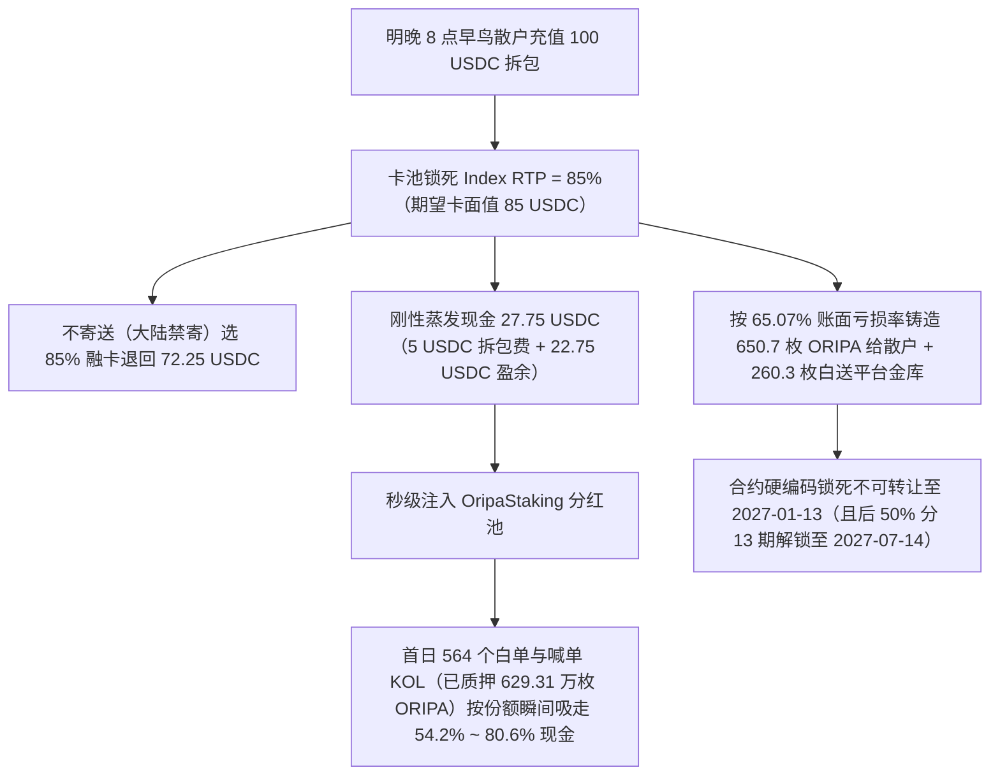

## ⚡ 核心结论与拍板速览

- **唯一确定性裁决**：⛔ **`WATCH_ONLY_ZERO_POS`（坚决不干 · 0 仓位空仓观望）**。**严禁**点击任何 KOL 邀请链接（如 `FBG53BDD`）去铸造所谓的“免费早鸟徽章 NFT（`ORIPA-EB`）”，更**严禁**在明晚 8 点（`2026-11-26 20:00 UTC+8`）向 `Oripa` 充值哪怕 `1 USDC` 参与拆包“挖头矿”；死守 `400U` 交易本金防线（单笔最大允许净亏损 `10U ~ 20U`），绝不给首日白单大户充当现金退出流动性。
- **一刀毙命的“狼等羊”数学死账**：全盘卡池设定 `Index RTP = 85%`、融卡折扣 `85%`，意味着散户每拆包融卡 `100 USDC`，**当场刚性净亏 `27.75 USDC` 真金白银（瞬时亏损率 `-27.75%`）**；而这笔 `27.75 USDC`（`5%` 拆包费 + `22.75%` 盈余）会**秒级全额分给当前已质押 `ORIPA` 的老地址**。截至 `2026-11-25 23:30 UTC+8`，首日 `564` 个白单与合作 KOL 钱包已抢先铸造并质押 **`6,293,126.30 枚 ORIPA`** 筑成抽水高墙——按积分实算，若明晚早鸟轮总成交 `50 万 USDC`，早鸟散户合计净亏的 `138,750 USDC` 现金中将有 **`111,845 USDC`（高达 `80.6%`）被首日白单/KOL 躺着抽走**；即便明晚顶格冲到 `200 万 USDC` 成交量，早鸟群体整体仍刚性净输 **`-300,881 USDC`（`-15.04%`）**，且换回的 `ORIPA` 代币被合约硬编码锁死至 **`2027-01-13`** 无法转让变现。
- **喊单大 V 隐藏钱包链上实锤抓包**：利用已售罄卡池公开的 `pool.json` 洗牌序列与链上 `DrawDebited` 事件交叉反推，精准剥出 `@MengLayer`（陈小萌）打码晒图背后的 HyperEVM 实盘钱包（尾号 `4a07f3`）。该地址凭借首日白单特权在 **`20:02:50 UTC+8`（发推喊单前整整 `82 分 58 秒`）** 即完成首笔头矿质押，累计质押 **`34,819.60 枚 ORIPA`**，目前已领走 **`2,306.58 USDC`** 现金分红（另待领 `74.12 USDC`）外加 `4` 张高价宝可梦卡（融卡报价合计 **`2,550.23 USDC`**），自身近乎零风险回本后，甩出纯链下返佣码催促散户明晚 8 点进场为其分红池抬轿。
- **四大底层暗雷叠加**：① 官网今日（`2026-11-25`）刚将**中国大陆正式列入违禁司法管辖区**且不支持大陆实物寄送，中文 KOL 却集中向大陆散户铺设邀请链接；② 链上实测兑付储备底线参数 `minHouseReserve = 0`、缓冲率 `remainderBufferBps = 0`，`96.8 万 USDC` 流水后庄家兑付池仅剩 **`5,433.59 USDC`**，且 `2/3` 多签可在**无时间锁**状态下随时调用 `withdrawHouse` 提走超额储备；③ `48 小时` 时间锁可升级合约对锁死 `50 天` 不可卖出的 `ORIPA` 持有人形同虚设；④ 早鸟徽章合约未开源、不在 BlockSec 审计范围内。
- **立即动作**：0 仓位旁观，直接将本次抓包出的**“盲盒洗牌序列反推大 V 钱包 + 首日白单抽走次日 80.6% 本金死账”**转化为 `@redkoi_eth` 推特四宫格打假帖与币安广场防割长文（满挂 3 个币安主力合约返佣标签），零本金收割全网早鸟轮 `3 万+` 关注者的搜索流量。

---

## 📊 全局统领：三轨分流与各批次筹码/现金流横向实算对账

| 博弈参与批次 / 策略选项 | 准入门槛与开放时间 (UTC+8) | 每投入 100 USDC 拆包融卡瞬时现金损益 | 铸造速率与代币真实折算成本 | 现金分红捕获率与退出流动性真相 | 合规与风控裁决 (对齐 400U 以损定仓) |
| :--- | :--- | :--- | :--- | :--- | :--- |
| **批次 A · 首日首秒白单科学家** (`Rank 1~7`) | 抽签白单 / 合作方 (`11-25 20:00:00`) | 瞬时损耗 `-27.75 USDC`（样本均值） | `10 枚/USDC` 账面亏损（实付现金成本 `0.0426 USDC/枚`） | 进场时总质押盘趋近 `0`，前 23 分钟独吞超 `10 万 USDC` 分红；榜一花 `5,000 USDC` 已净领 **`9,228.22 USDC`** 现金 | 特权内幕时段已结束，散户无入场通道 |
| **批次 B · 首日尾盘白单散户** (`如 @hualun 等`) | 抽签白单 (`11-25 21:30` 后) | 实测小资金极易连黑（如 `360U` 仅融回 `60U`，瞬亏 **`-83.3%`**） | 同为 `10 枚/USDC` 账面亏损，但已被前排稀释 | 面对 `629.31 万枚` 质押盘严重摊薄；尾盘大户 `0x5df6...caf6` 铸币 `3.99 万枚` 仅分回 **`147.09 USDC`** | 现金回本周期拉长至 `15 天+`，后续无增量即血亏 |
| **批次 C · 明晚 8 点早鸟徽章轮** (`孟总喊单接盘盘`) | 免费铸造灵魂绑定 `ORIPA-EB`（已铸 `30,681 枚`），`11-26 20:00` 开拆 | 拆 `100 USDC` 期望立亏 **`-27.75 USDC`**；拆 `400 USDC` 立亏 **`-111.00 USDC`**（击穿 `10~20U` 止损红线） | 虽仍在 `500 万 USDC` 平坦段（当前进度 `12.60%`），但真实对应 `3,284 万 USD` 现金消耗 FDV + 平台白拿 `28.57%` 代币 | **标准“狼等羊”负和填坑**：首秒冲入 `100U` 需后续再进场 **`172 万 USDC`** 接盘资金才能勉强现金保本；若明晚成交 `50 万 U`，早鸟整体净输 `80.6%` 本金给首日 KOL | ⛔ **绝对禁区**：赌性抽卡方差极大 + 代币锁死至 `2027-01-13` + 大陆违禁区 |
| **方案 D · RedKoi 0 仓位防割打假变现（唯一推荐）** | **0 本金投入**、不连钱包、不打徽章 | **`0.00 USDC` 亏损**（`400U` 本金 100% 留存） | 零持仓风险 | 吃透 `30,681` 名早鸟徽章持有者明晚开盘前后的焦虑检索流量，赚取币安广场手续费返佣 | 🟢 **唯一正期望最优解 (`WATCH_ONLY_ZERO_POS`)** |



---

### 🔍【项目穿透研报】Oripa / ORIPA（HyperEVM 宝可梦盲盒亏损挖矿盘与喊单钱包链上刑侦）

#### 1. 🪪 靶标身份证与链上/舆情硬真值表（客观数字仅此一处）
- **基本盘定位**：日式宝可梦评级卡链上抽卡盲盒（Gacha）与“亏损挖矿（Loss-Mining）”分红协议 / **HyperEVM 主网（Chain ID `999`）** / 已部署主网代币合约但 **`2027-01-13 00:00 UTC` 前全局锁死不可转账、零 DEX 二级流动性** / 运营主体 `Spatial Temporal Markets Ltd`（英属维尔京群岛 BVI 离岸公司，底层代码直接移植自 Monad 生态高杠杆对赌盘 `Papertrade`）
- **原生合约与关键链上地址（独立代码块，便于核验）**：
  - `ORIPA` 代币主合约（UUPS Proxy，实现合约 `0x4e33fb6a98683cfb296cdc9ab786350a3ef2868b`）：
    ```text
    0x68A042e03088c50b7644e34B0FddFFdfd19D828d
    ```
  - `OripaExchange` 资金与兑付储备总金库（UUPS Proxy，托管全部用户余额、庄家储备与待领分红）：
    ```text
    0x66A9212a402746E0D5b9F17Dc80c8101208d684d
    ```
  - `OripaStaking` 质押分红账本合约（UUPS Proxy）：
    ```text
    0x5Ad23DFE4B444FB04C6bEa01Df27E17A07C7f900
    ```
  - `OripaPools` 卡池哈希承诺注册表合约（UUPS Proxy）：
    ```text
    0x4C7Af937C9c7daD52c2Ac5442A324a049FD8eC9d
    ```
  - `oripa Early Bird`（`ORIPA-EB`）早鸟徽章灵魂绑定 NFT 合约（**未在 Sourcify 开源验证、未纳入 BlockSec 审计**，Owner 为单签 `0x40cf7a23c3690cab1f0faee8858be06bcf5e7ae1`）：
    ```text
    0x0044d45a844b4e3439cff259f5e38f30edf2684e
    ```
  - `48 小时` 升级时间锁合约（`TimelockController`）与 `2/3` 核心管理/金库多签（`AdminSafe` / `Treasurer`）：
    ```text
    0x26F52E9f9953986e87d25062AA87Fab40840D6a4
    ```
    ```text
    0xd567DF414B8eacf8B45Fae7c293e7a758F657131
    ```
  - 链上实锤剥出的 `@MengLayer`（陈小萌）首日白单实盘钱包：
    ```text
    0xcb96d76991f3e2230ab9383a7dda320f4c4a07f3
    ```
- **【情报源】与链上验真**：`alpha_preflight.py` 确定性探针（`Rule 37 = CLEAR`，`oripa.xyz` 主站触发 Cloudflare `HTTP 403` 防护礼貌降级） / 官方文档站 `docs.oripa.xyz/llms-full.txt` 全量白皮书（`93.3 KB`） / BlockSec 官方签名审计报告 PDF（`2026-11-13` 签发，共 `23` 页） / Sourcify Chain `999` 已验证全套 Solidity 源码（`OripaToken.sol`、`OripaExchange.sol`、`OripaStaking.sol`、`OripaPools.sol`） / 官方实时账本接口（`api.oripa.xyz/stats`、`/pools`、`/leaderboard` 及已开奖卡池 `pool.json`） / HyperEVM 官方原生 RPC（区块高度 `52,206,861 ~ 52,219,587`）`eth_call` 与 `eth_getLogs` 逐笔穿透 / 远端只读推特检索扫描中文 KOL 邀请矩阵与域名 WHOIS（`oripa.xyz` 注册于 `2026-08-05`，GitHub 组织 `unravel-cards` 创建于 `2026-09-08` 且公开仓库数为 `0`）。
- **硬指标快照（截至 `2026-11-25 23:31 UTC+8`，区块 `52,219,587`）**：全网 DEX 聚合流动性 `0 USD`（代币锁死不可转账） | `OripaExchange` 链上真实托管总资产 `185,055.50 USDC`（其中用户未动用余额 `108,348.53 USDC`、待领分红池 `71,273.38 USDC`、**庄家卡片融化兑付储备 `houseBalance` 仅剩 `5,433.59 USDC`**） | 首日总拆包流水 `968,040.00 USDC`（共 `8,905` 次拆包、`16,799` 卡包，综合中奖率 `25.03%`，累计账面亏损 `H = 629,879.91 USDC`） | 已铸造总供应量 `8,818,318.74 枚 ORIPA`（散户 `6,298,799.10 枚` 中已质押 `6,293,126.30 枚` 共 `564` 人，平台 `Vault` 白拿 `2,519,519.64 枚`） | 渐近总供应上限 `7.70 亿枚`（按真实净现金损耗折算隐含起步 FDV `3,283.89 万 USD`，按名义 `0.10 USD` 亏损额折算 FDV `7,700.00 万 USD`） | 早鸟徽章 `ORIPA-EB` 已铸总量 **`30,681 枚`**（单价 `0 HYPE`，单笔 Gas 约 `0.000081 HYPE`） | 合约最高权限 `2/3 多签 + 48h 时间锁可升级（但金库提款无时间锁）` | SmartMoneyRadar 实名聪明钱命中 `0`。
- **【推特共振原帖与精译存证】**：
  - **触发原帖与喊单漏斗**：中文区博主 `@MengLayer`（陈小萌，粉丝 `23,120`，建号 `2021-05-14`）自 `11-22` 起连续铺垫：`11-22 19:46 UTC+8` 发帖称“跟项目方申请了个 Boost，用下面链接 Mint NFT，直接 26 号开干”（附带邀请码 `FBG53BDD`）；今晚 `11-25 20:23:57 UTC+8`（浏览 `10,008`）晒出一张刻意裁掉右上角钱包地址的 4 张皮卡丘/甲贺忍蛙高价卡截图配文“哈哈爽~”；随后于 **`21:25:48 UTC+8`**（原帖 `2125581721374806443`，浏览 `7,008`）引用晒单图高呼：“明晚上 8 点你不去干 Oripa 那你白玩了！目前 Orip 的铸造曲线只走了十分之一，白单基本都打完了，明天晚上 8 点铸造过 NFT 的人第一时间冲进去也能爽吃铸造头矿，年化几万吧。速度！”
  - **链上秒级还原与隐藏钱包破译铁证**：通过提取其晒单图中 4 张卡片的精确锁定估值（`Ash's Pikachu 943.02 USDC`、`Ash-Greninja-EX 504.40 USDC`、`Sapporo's Pikachu 683.38 USDC`、`Mega Tokyo's Pikachu 869.49 USDC`）及倒计时，比对已售罄 `250 USDC` 档卡池 `usd-250-20261125-1-p4804` 公开的 `pool.json`，4 张卡 100% 唯一命中连续槽位 `seq 77~78`（交易哈希见附录，发生于 `20:04:11 UTC+8`）与 `seq 207~208`（区块 `52,207,180`），从而铁证锁定孟总钱包为 `0xcb96d76991f3e2230ab9383a7dda320f4c4a07f3`！链上日志证实：该地址早在 **`20:02:50 UTC+8`（发推吹票前 `82 分 58 秒`）** 已质押首笔 `10,794.60 枚 ORIPA`，随后累计质押达 **`34,819.60 枚 ORIPA`**，截至取证时已实领 **`2,306.58 USDC`** 现金分红（另待领 `74.12 USDC`）且手握上述 `2,550.23 USDC` 可融化卡片——**自己靠首日特权白单把本金几乎全数收回并锁死头矿份额后，反手用“年化几万”诱骗粉丝明晚 8 点冲进去亏掉 `27.75%` 现金给他的质押仓发分红！**
  - **中文区 KOL 矩阵集中派发痕迹**：同步监测到今晚 `20:00 ~ 23:25 UTC+8` 期间，`@0xYond`（邀请码 `S4TCUC96`）、`@wenxue600`（`VQMTF7ZD`）、`@vvickym2`（`MY4G7HP9`）、`@pcobidco`（`G43JTTDE`）、`@The_Wooo`（`RJX5ZHJT`）、`@AirdropAlchemis`（`J4MRBJN8`）、`@Supers6061`（`KP66GEY9`）、`@ZF_lab`（`R8TH6FBM`）、`@yyds123888`（`EVU3BEJU`）等数十个中文大 V 使用高度雷同话术（晒“某群友 1 万 U 变 3 万 U”神话 + 强调“明晚还有 3 万人排队进场” + 附专属短链）整齐划一催促散户明晚接力。
- **一句话本质**：把日本秋叶原高抽水宝可梦盲盒搬上 HyperEVM，套上 Monad 对赌盘 `Papertrade` 的“亏损铸币 + 后来者拆包亏损秒分给前排质押者”庞氏时间优先分红壳——**首日 564 个特权白单/KOL 已经建好 `629.31 万枚` 抽水大坝，明晚 8 点的早鸟轮本质上是“群狼排好队等 3 万只散户羊进场献祭 27.75% 现金”的精准收割局。**

---

#### 2. ⚡ 生死大前提、团队自我设限与【极限容量死账】
- **创始人格局与【主动自我设限】审查（表面写满君子协定，底层暗藏四处致命口子 · 不合格）**：
  1. **匿名套壳与代码换皮底细**：运营方为 BVI 离岸壳公司 `Spatial Temporal Markets Ltd`，RootData 与官网无任何实名创始人或机构融资背书。审计我们拉取的 Sourcify 链上验证源码可见，`OripaToken.sol` 与 `OripaExchange.sol` 多处遗留未删干净的工程注释（如 `same as Papertrade`、`USDC has 6 decimals on Monad`、`Added in v10, Aaron`），实锤该协议直接复用了 Monad 亏损挖矿赌盘 `Papertrade` 的合约骨架，仅将开奖标的从虚拟合约换成了链下托管的宝可梦评级卡。
  2. **返佣机制（Referral / Boost）真相穿透**：穿透 `ORIPA-EB` 徽章合约交易输入数据（纯 `4 字节` 函数选择器 `0x1249c58b` 无参数）及全套 `OripaExchange` 合约确认，**链上智能合约内根本不存在任何邀请返佣分账或铸币加成（Boost）逻辑**！官方白皮书亦明确写死“所有钱包适用完全一致的铸造速率”。所谓 KOL 专属链接（`oripa.xyz/FBG53BDD` 或 `?ref=xxx`）100% 是**纯链下前端归因追踪码**——一方面帮项目方考核 KOL 拉新人数以发放首日合作白单名额（`launch partners`）或场外商务激励，另一方面更阴险的是：KOL 每拉来一个明晚冲进去拆包的粉丝，粉丝当场亏掉的 `27.75%` 现金就会顺着链上分红池直接流进这批首日已建仓 KOL 的口袋！
  3. **合约权限、储备金掏空风险与“时间锁失效悖论”核查**：
     - **零预挖假象下的 `28.57%` 零成本抽成**：虽然宣称不收拆包手续费，但合约硬编码 `vaultBps = 4000`——散户每靠真金白银亏损铸出 `100 枚 ORIPA`，系统自动凭空增发 **`40 枚 ORIPA`（占总盘 `2/7 ≈ 28.57%`）** 打入团队 `VaultSafe`（`2027-03-16` 起解锁）。
     - **储备金底线 `minHouseReserve = 0` 裸奔与无时间锁提款**：白皮书承诺按未交割卡片价值的 `85%` 每日写入 `minHouseReserve` 锁死兑付准备金，源码注释亦宣称主网保留 `10%` 缓冲垫（`remainderBufferBps = 1000`）。**但链上 `eth_call` 现场抓包显示：`minHouseReserve = 0` 且 `remainderBufferBps = 0`！** 导致首日几乎全部正盈余被直接扫入分红池，支撑全网未融化卡片兑付的 `houseBalance` 仅剩区区 **`5,433.59 USDC`**（仅孟总一人晒出的 4 张卡融化负债就占掉 `46.9%`），一旦后续拆包断流极易触发集中融卡排队停兑；更危险的是，`AdminSafe`、`VaultSafe` 与 `GuardianSafe` 背后由**完全相同的 3 个匿名私钥**（`0x482f...6186`、`0x594b...845e`、`0x0769...6fa6`）控制，且 `AdminSafe` 直接持有 `TREASURER_ROLE`（**不经过 48 小时时间锁**），在 `minHouseReserve = 0` 状态下随时可单笔调 `withdrawHouse` 抽干庄家池！
     - **锁仓期内的 UUPS 可升级死穴**：虽然用户账户内未拆包的可用 `USDC` 提现（`withdraw`）无暂停开关且无黑名单函数，但全套核心合约均为 `UUPSUpgradeable`（`48 小时` 时间锁）。对于锁死至 **`2027-01-13`（长达 50 天 = 1,200 小时）** 严禁转让的 `ORIPA` 质押者而言，即便团队提交恶意升级提案（如调 `setStaking` 截断分红或篡改合约），持币者在 `48 小时` 窗口内也根本无法卖币逃生！
     - **“单钱包 5,000U 限额”文字游戏与中国大陆合规杀猪**：`OripaExchange.sol` 第 `769` 行仅校验单次充值后的**瞬时账户余额** `walletBalanceCap <= 5,000 USDC`（而非累计消费上限），首日科学家拆完融卡即可无限循环再充（榜一 `0x5df6...caf6` 首日狂拆 `405` 次！），且团队已于 `11-23` 提交时间锁提案（`0x3ae717fe...`）准备在 `12-02` 彻底取消限额。同时官方文档于今日（`11-25`）刚刚把**中国大陆加入禁止访问与服务地区**，实物卡仅发日韩台港（运费 `25 USDC`），大陆散户若遇卡池纠纷或风控封号将彻底丧失追索权。
- **大白话业务真容四问**：
  - *搬了什么上链*：没有把卡片所有权做成可自由交易的链上 NFT，只把卡池清单的 SHA-256 承诺哈希与 `USDC` 扣款/分红账本放在了 HyperEVM，实物宝可梦卡全部锁在项目方链下黑箱金库，每日日元指数价也由项目方自己算。
  - *用户怎么玩*：充 `USDC` 买 `5 / 10 / 25 / 50 / 250 USDC` 一抽的盲盒 -> `75%` 概率抽中便宜废卡（Miss）-> `24 小时` 内不花 `25 USDC` 寄走就按指数价 `85 折` 融回 `USDC` -> 账面差额亏损按曲线铸成锁仓 `ORIPA` -> 质押 `ORIPA` 等后面进来的倒霉蛋拆包亏钱给你分 `USDC`。
  - *代币通缩与流转闭环*：**没有任何代币销毁或协议回购机制**！`ORIPA` 只增不减（渐近上限 `7.70 亿枚`），唯一赋能是瓜分后续赌客的拆包抽水。
  - *FOMO 驱动力*：首日零质押基数下前 `20` 个秒冲钱包“20 分钟翻倍回本还赚几千刀”的真实链上幸存者偏差截图，配合 KOL 刻意隐瞒分母膨胀的“年化几万”话术。
- **【极限容量/回本死账公式】与市梦率 (Price-to-Dream Ratio)**：
  - **铸造曲线（Bonding / Loss Curve）精确方程**：设全平台累计账面亏损为 `H`（单位 `USDC`），平坦段阈值 `T = 5,000,000 USDC`，衰减尺度 `S = 50,000,000 USDC`：
    ```text
    当 H < 5,000,000 时：R(H) = 10 枚 ORIPA / 1 USDC 亏损（累计最多铸出 5,000 万枚用户币 + 2,000 万枚金库币）
    当 H >= 5,000,000 时：R(H) = 10 × [50,000,000 ÷ (50,000,000 + H - 5,000,000)]^2（无穷积分上限 5 亿枚用户币 + 2 亿枚金库币）
    全盘硬顶死账：散户需累计真实账面亏损无穷大（仅前 50% 供应就需亏损 5,500 万 USDC），才能铸满 5.5 亿用户币 + 2.2 亿平台币 = 7.7 亿总供应量！
    ```
  - **明晚 8 点早鸟轮回本死账公式（工科积分精算）**：
    ```text
    单次拆包融卡刚性失血率 = 1 - (卡池 RTP 0.85 × 融卡率 0.85) = 27.75%（实测首日分红率 268,748 ÷ 968,040 = 27.76%）
    实测单枚 ORIPA 净现金硬成本 = 27.75 USDC 真实失血 ÷ (100 USDC × 实测亏损率 65.07% × 10 枚) = 0.04265 USDC / 枚（对应 7.7 亿总量隐含现金消耗 FDV = 3,283.89 万 USD）
    早鸟首秒入场现金保本所需后续接盘流水 V_breakeven：因起跑前已被首日 564 人压住 S0 = 6,293,126.3 枚质押盘，即使明晚 20:00:01 首秒冲入，后续全网必须再烧掉 >= 1,720,000 USDC 拆包流水，你的累计 USDC 分红才能刚刚填平自己瞬时亏掉的 27.75% 本金！
    市梦率 = 叙事造梦天花板容积 (分子归零 · 纯负和抽水左脚踩右脚 + 50 天死锁期) ÷ 试错门票成本 (分母极高 · 进场立砍 27.75% 本金 + 高方差连黑风险) -> 典型【特权白单建仓完毕、引诱次日散户进场派发接盘踩踏期】
    ```

---

#### 3. ⚔️ 庄散博弈与红蓝终局交锋（单次开庭 · 零复读）
- **蓝方正方亮点**：协议工程完成度明显高于草台土狗——`6` 个核心资金结算合约经 BlockSec 签名审计并在 Sourcify 完整开源验证；卡池采用 `SHA-256(commit.json) + 创世区块哈希 Fisher-Yates 洗牌` 实现了可离线脚本复核的公平随机开包；用户账户可用 `USDC` 提现未设暂停开关，且在首日高并发下确实向早期质押者真实派发了 `26.87 万 USDC`。
- **红队无情挑刺与暗坑**：① **时间优先权极端不对称的“庞氏抽水漏斗”**：首日白单面对的是 `0` 存量质押盘，而明晚早鸟散户面对的是 `629.31 万枚` 存量吸血鬼盘——明晚早鸟群体作为一个整体，无论成交 `50 万` 还是 `1,000 万 USDC`，在数学上**100% 注定净输巨额现金给首日白单层**，所谓“头矿年化几万”纯属拿首日首秒瞬时斜率偷换次日稀释后收益的骗炮话术；② **小本金高方差破产毒丸**：`RTP = 85%` 靠极少数高价大奖卡拉高均值，中位数全是亏本废卡（全网失手率 `74.97%`），`400U` 量级资金进去拆几发极易重演 `@hualun`“拆 `360U` 仅剩 `60U`”的 `-83%` 瞬时重伤，直接打穿以损定仓底线；③ **兑付储备 `minHouseReserve = 0` 与锁仓期可升级双杀**：庄家兑付池仅留 `5,433.59 USDC` 裸奔，且代币锁死至明年 `1 月 13 日`（待那时尚有 `50%` 抛压集中开闸，外加平台零成本 `Vault` 盘压顶），二级开盘谁去接这 `3,284 万 ~ 7,700 万 USD` FDV 的盘？
- **庄家意图与【RedKoi 定案·大庄格局四维刑侦框架】**：
  - *控盘意图（拒绝纯查死地址流水）*：项目方操盘极其老辣——自己表面不抽拆包现金，实则既省去了早期买量费用（用 Day 1 白单暴富效应喂饱中文 KOL，让 KOL 免费卖命拉 `3 万+` 早鸟散户来给 Day 1 分红），又零本金白拿全网 `28.57%` 代币等明年解锁变现，同时靠 `15%` 融卡折价与卡片指数定价差把实物卡库存周转风险全数转嫁给赌客与质押者。
  - *四维体检*：① **主池资本沉淀反向质押率**：二级 DEX 池深为 `0 USD`（锁死期），而协议内 `houseBalance` 兑付储备仅占首日流水的 **`0.56%`**（`5,433.59 / 968,040`），资金沉淀极度脆弱；② **LP 锁仓期限与做市权限**：无二级 LP，核心合约由同一批 3 人控制的 `2/3 Safe` 掌握 `48h` 升级权与 `0 延时` 超额储备提款权；③ **独立老地址换手承接**：当前仅 `564` 个白单地址场内互博，前十大质押地址占比 `6.84%`（`top10ShareBps = 684`），实名机构聪明钱命中为 `0`，门外 `30,681` 个免费早鸟徽章大多为撸毛散户与多号工作室；④ **核心团队实名与生态违约成本不对称**：BVI 匿名壳 + GitHub 零公开仓库 + 提前拉黑中国大陆免责，违约成本极低。
- **【审判结论】**：**偷换概念 / 伪命题高危**（用审计过的链上盲盒外壳包装“前排白单收割后排散户 `27.75%` 拆包本金”的负和博弈局，早鸟轮散户进场即成猪仔盘现金燃料）。

---

#### 4. 🎯 行动裁决、内容变现切口与唯一链上证伪线
- **终局定性**：⛔ **[WATCH_ONLY_ZERO_POS]**（严守 `400U` 本金与零土狗/零负和赌盘铁律：不点邀请链接、不打灵魂绑定早鸟 NFT、明晚 8 点绝不充 `USDC` 拆包）。
- **唯一链上证伪重审线**：唯有同时满足以下三项链上硬指标才值得在 `2027-01-13` 代币解锁后重审：① `OripaExchange` 链上 `params.minHouseReserve` 恢复每日真实非零写入且储备覆盖率持续 `>= 100%`；② `12-02` 公开轮开启两周后，在无新铸币补贴噱头下仍有日均 `>= 20 万 USDC` 的纯集换卡收藏消费流水（实物发运率显著上升而非 `99%` 秒融卡挖矿）；③ `2027-01-13` 首轮 `50%` 解锁抛压充分换手后，二级 DEX 聚合池深稳定 `>= FDV 的 15%`。
- **内容变现切口（`@redkoi_eth` 短钩子 + `1600×900` 四宫格对账卡 + 币安广场长文）**：
  - *短钩子标题切入点*：《全网吹爆明晚 8 点“年化几万”的 Oripa 早鸟头矿？我用盲盒洗牌算法扒出了喊单大 V 打码隐藏的钱包，算完这笔 80.6% 抽水死账劝你立刻收手！》
  - *`1600×900` 对账卡四宫格核心数据*：
    - `[格1: 宣传噱头 vs 拆包死账]`：吹嘘“明晚 8 点早鸟躺吃几万年化” vs 拆 100 USDC 融卡立亏 27.75 USDC，需后续 172 万 USDC 接盘才能现金回本
    - `[格2: 首日吸血鬼墙真值]`：564 个白单已质押 629.31 万枚 ORIPA，明晚若成交 50 万 U，早鸟亏损本金的 80.6%（11.18 万 U）直接进前排腰包
    - `[格3: 喊单钱包精准抓包]`：槽位指纹锁定 0xcb96...07f3 提前 83 分钟质押 3.48 万枚、已领 2,306 USDC + 2,550 USDC 卡面回本后再发无加成邀请码
    - `[格4: 合规与合约四重暗雷]`：11-25 刚将中国大陆列为违禁区且禁寄实物 + 链上 minHouseReserve=0 仅剩 5,433 U 兑付池 + 代币死锁至 2027-01-13
  - *币安广场 Write-to-Earn 转化配置*：正文将 `ORIPA` 纯文本脱敏书写（严禁占用返佣卡槽），围绕公链高性能博弈生态主题满配挂齐 `SOL`、`ETH`、`BNB` 三个币安高成交主力合约标签及右侧风控纪律，吃满明晚 `3 万+` 早鸟用户的防割避险流量。

---

<details><summary>🔍 附录：实测存证与情报来源（点击展开）</summary>

- **触发原帖与引用链核验 URL**：
  ```text
  https://x.com/MengLayer/status/2125581721374806443
  ```
  ```text
  https://x.com/MengLayer/status/2125566156811682108
  ```
  ```text
  https://x.com/MengLayer/status/2124469592630469081
  ```
- **官方文档全量索引与实时链上对账 API**：
  ```text
  https://docs.oripa.xyz/llms-full.txt
  ```
  ```text
  https://api.oripa.xyz/stats
  ```
  ```text
  https://api.oripa.xyz/leaderboard?by=claimed
  ```
  ```text
  https://api.oripa.xyz/pools/usd-250-20261125-1-p4804/pool.json
  ```
- **BlockSec 签名安全审计报告原文（`2026-11-13`）**：
  ```text
  https://raw.githubusercontent.com/blocksecteam/audit-reports/main/solidity/blocksec_oripa_oripa_contract_signed_20261113.pdf
  ```
- **关键链上实锤交易哈希（HyperEVM Chain ID `999`）**：
  - `@MengLayer` 隐藏钱包首笔头矿质押交易（`2026-11-25 20:02:50 UTC+8`，区块 `52,207,007`，早于喊单推文 `82 分 58 秒`）：
    ```text
    0xd6eedad79c42c3f05b1919adb03e323fbcd706fc329a53349c405f0fb6faa510
    ```
  - `@MengLayer` 命中 `Ash's Pikachu`（`seq=77`）与 `Ash-Greninja-EX`（`seq=78`）连续槽位的 `1,250 USDC` 五连抽交易（区块 `52,207,090`）：
    ```text
    0xef5aacf15758e558b9f3da9f756a729d740e4f67c42d3334c5e5f5e661fc310b
    ```
  - `@MengLayer` 命中 `Sapporo's Pikachu`（`seq=207`）与 `Mega Tokyo's Pikachu`（`seq=208`）连续槽位的 `1,250 USDC` 五连抽交易（区块 `52,207,180`）：
    ```text
    0x4b728ad769f8c591cf6dadda73947adc04baaa720f55d62545ca2f0ead63d3bf
    ```
  - 团队提交的 `2026-12-02` 解除单钱包 `5,000 USDC` 余额上限时间锁提案交易：
    ```text
    0x3ae717fe477381cd048268903154006918f861a8931a2b102279eaf510e4eeb6
    ```
  - 早鸟徽章 `ORIPA-EB` 零成本铸造样本交易（输入数据仅 `0x1249c58b`，实锤无任何链上返佣参数）：
    ```text
    0xb7a75f943e7c832c30e326edb3da81238cff3a508630d69ca46a34e5a956a801
    ```
- **测算口径与验证复现命令**：
  - 全部链上状态通过 HyperEVM 官方节点 `https://rpc.hyperliquid.xyz/evm` 实测读取，积分模型采用连续微元步长 `steps = 10,000` 模拟首日存量质押 `S0 = 6,293,126.30 ORIPA`、累计亏损起点 `H0 = 629,879.91 USDC`、实测账面亏损转换率 `65.07%` 与刚性现金分红注入率 `27.75%`。
  - 门禁自检命令：
    ```bash
    python3 /home/ubuntu/pi-data/scripts/report_invariants.py /home/ubuntu/web3-alpha-reports/reports/2026-11-25_oripa.md --has-valid-mentions
    ```

</details>
